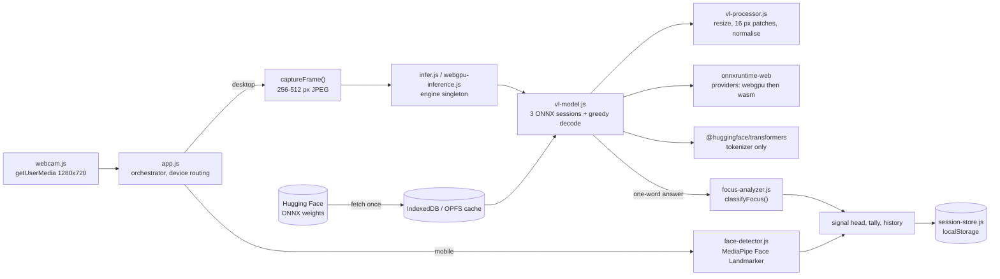

# AI Focus Monitor (WebGPU)

A webcam demo that runs a vision-language model entirely in the browser on WebGPU and turns its one-word answer into a three-lamp signal: focused, distracted, or absent.

**Live demo:** https://image-web-gpu.vercel.app

> The live deployment, checked on 2026-10-28, shows a later revision titled "로컬 비전 신호등" ("local vision signal"). That copy says the app does not measure focus. Its source is not on `main` yet. This README describes the code on `main`.

## Problem

Most webcam AI demos upload frames to a server. This app downloads the model weights once and caches them in the browser. After that, every frame is analysed on the visitor's own GPU, and no video leaves the device. The hard parts are running a 316 MB to 2.3 GB multimodal model inside a browser tab, and keeping a phone from crashing on the same page.

## Architecture



On desktop, the app captures one frame, runs the model, classifies the answer, and then captures the next frame. On mobile, MediaPipe runs on every animation frame and the history logs one verdict every 3 seconds. More detail is in [docs/architecture.md](docs/architecture.md).

## Key technical decisions

- **A custom ONNX Runtime runner instead of a Transformers.js pipeline.** `src/vl-model.js` loads three separate sessions (token embeddings, vision encoder, decoder) and runs the decode loop by hand with conv-state and KV caches. `src/vl-processor.js` ports the LFM2-VL Python image processor. Transformers.js is used only for the tokenizer. One per-model `arch` entry in `src/config.js` covers both the 450M and 1.6B file layouts.
- **Weight caching depends on file size.** In `src/vl-model.js`, files that fit in memory are streamed into one pre-allocated buffer and stored in IndexedDB. The Cache API was dropped because large writes failed on Safari (commit `3fb8ac5`). On mobile, files over 50 MB are streamed into OPFS and handed to ONNX Runtime as a blob URL. If OPFS is unavailable, the runtime gets the remote URL directly. See [ADR 0002](docs/adr/0002-size-based-weight-caching.md).
- **Mobile uses face landmarks, not a VLM.** LFM2-VL-450M and then SmolVLM-256M both crashed mobile browsers on memory (commits `175426d`, `ab56c58`). Phones now run MediaPipe Face Landmarker, a model of about 3.6 MB, with rule-based head-pose, eye-closure, and gaze checks in `src/face-detector.js`. See [ADR 0001](docs/adr/0001-mobile-face-landmarks-instead-of-vlm.md).
- **WebGPU with a WASM fallback.** Sessions are created with `executionProviders: ['webgpu', 'wasm']` (`src/vl-model.js`). The UI probes `navigator.gpu.requestAdapter()` and shows a "CPU 모드 (느림)" badge when WebGPU is missing (`src/app.js`). WASM threads are pinned to 1 because worker threads failed on a `document` access error (commit `b87f0ac`).
- **The heavy runtimes load on demand.** `infer.js` and `face-detector.js` are loaded with dynamic `import()` from `src/app.js`. The entry chunk in the CI build of this branch (2026-10-28) was 16.38 kB. The `infer` chunk was 1,294 kB, plus the ONNX Runtime `.wasm` files.

## Models

| Path | Model | Download | Source |
|------|-------|----------|--------|
| Desktop (default) | LFM2-VL-450M, Q4F16 | ~316 MB | `onnx-community/LFM2-VL-450M-ONNX` |
| Desktop | LFM2.5-VL-1.6B, Q4 decoder and Q4 vision encoder | ~1.8 GB | `LiquidAI/LFM2.5-VL-1.6B-ONNX` |
| Desktop | LFM2.5-VL-1.6B, Q4 decoder and FP16 vision encoder | ~2.3 GB | `LiquidAI/LFM2.5-VL-1.6B-ONNX` |
| Mobile | MediaPipe Face Landmarker, float16 | ~3.6 MB | Google Storage |

Sizes are the labels from `src/config.js`. The app asks the VLM for one word ("focused", "distracted", or "absent") and decodes greedily, with at most 128 new tokens.

## Run locally

Requires Node 22 (the version used in CI). For the GPU path, use Chrome or Edge with WebGPU.

```bash
npm ci
npm run dev        # http://localhost:3000, served with COOP/COEP headers
npm test           # node:test unit tests
npm run build      # production bundle in dist/
npm run preview
```

Set `VITE_DEFAULT_MODEL` to one of the model IDs in `src/config.js` to change the default model.

## Testing

`npm test` (Node's built-in `node --test`) on 2026-10-28 with Node 22.19.0: **18 passed, 0 failed, 0 skipped**, in 3 files.

| File | What it covers |
|------|----------------|
| `tests/focus-analyzer.test.js` | Post-processing: mapping the model's text answer to a verdict, including quoted or markdown one-word answers |
| `tests/vl-processor.test.js` | Pre-processing: smart resize, the 64-256 image-token budget, the tile grid, patch normalisation to [-1, 1], and the padding mask |
| `tests/session-store.test.js` | The session tally, the 20-entry history, and corrupt-storage handling |

`npm run build` also passed on the same date. GitHub Actions (`.github/workflows/ci.yml`) runs `npm ci`, `npm test`, and `npm run build` on pull requests and on pushes to `main`. No lint or typecheck step is configured.

Not covered by automated tests: WebGPU sessions, model download and caching, the camera, and MediaPipe. These need a real browser and GPU.

## Limitations and next steps

- The verdict is a heuristic: a one-word model answer, or face-landmark rules on mobile. Its accuracy has not been measured. The two paths use different methods, so their verdicts are not comparable.
- `src/smolvlm.js` is no longer imported anywhere. It is left over from the SmolVLM mobile experiment (commit `ab56c58`).
- `src/face-detector.js` loads the MediaPipe WASM from `@mediapipe/tasks-vision@latest` and the model from a `latest` path. The JS package is pinned to `^0.10.33`, so a future upstream release could drift out of step with it.
- The production build contains two ONNX Runtime WebGPU `.wasm` files (21.6 MB and 25.0 MB): one from `onnxruntime-web` 1.24.3, which runs the model, and one from the `onnxruntime-web` 1.22.0-dev build nested under `@huggingface/transformers` 3.8.1, which is used only for the tokenizer. Removing the duplicate would save about 21.6 MB of deploy size.
- Mobile detection uses the user-agent string and screen width, so tablets with large screens get the desktop VLM path.

## Privacy

Frames are processed on the device and are not sent to any server. Model weights are downloaded from Hugging Face (VLM) or Google Storage (MediaPipe), and the MediaPipe WASM comes from jsDelivr. All of them are cached by the browser. The app has no backend and no analytics.

## License

MIT
